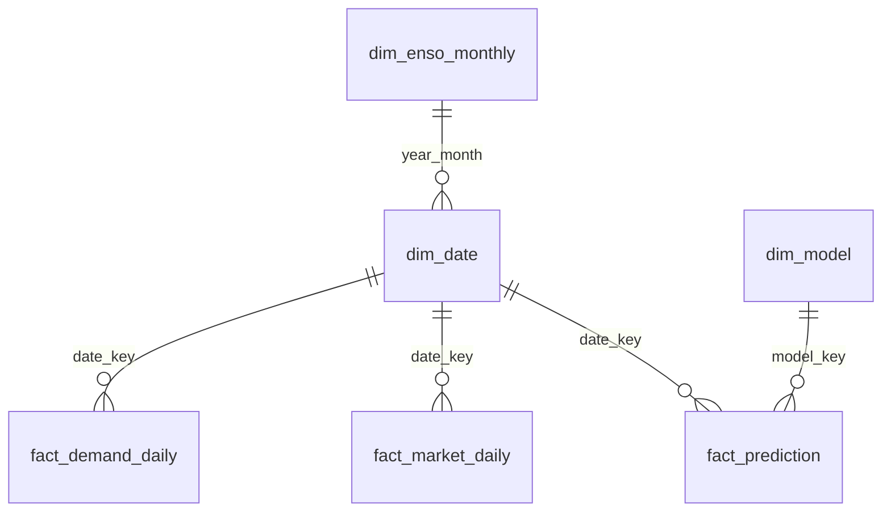

# Power BI report: build and publish guide

Generate a star-schema dataset with one command, load it in Power BI Desktop (Import mode),
paste the DAX measures, build five pages, then "Publish to web" and put the iframe URL in the
site. The report holds the macro analysis (price, hydrology, demand structure, model quality);
the per-date prediction chart lives natively in the app.

## Quick path

1. Generate the data: `python scripts/run_powerbi_export.py` (CSVs land in `data/powerbi/`).
2. Power BI Desktop: Get Data -> Folder, load the 6 CSVs, apply the types below.
3. Model: mark `dim_date` as date table, create relationships, paste `dax_measures.dax`.
4. Import `theme.json`, build the 5 pages.
5. Publish, then File -> Embed report -> Publish to web, copy the iframe `src` into
   `VITE_POWERBI_EMBED_URL`.

## 1. Generate the dataset

```bash
# Default range 2000-01-01..2023-12-31; first run downloads and caches XM/NOAA responses
python scripts/run_powerbi_export.py

# Small range, no database
python scripts/run_powerbi_export.py --start 2023-01-01 --end 2023-03-31 --skip-db

# Reproduce from cache only (no network)
python scripts/run_powerbi_export.py --skip-network
```

If `import powerbi` fails, the editable install predates the new package: run
`pip install -e .` again (or set `PYTHONPATH=src`).

| Table | Grain | Source |
|-------|-------|--------|
| `dim_date` | 1 row per day (+ Colombian holidays, Spanish names) | generated |
| `fact_demand_daily` | day | `data/interim/energy_demand_daily.parquet` (XM) |
| `fact_market_daily` | day | XM API: `PPPrecBolsNaci`, `PorcVoluUtilDiar`, `AporEner` |
| `dim_enso_monthly` | month (`year_month` = yyyymm) | NOAA ONI, El Niño >= +0.5, La Niña <= -0.5 |
| `dim_model` | model version | PostgreSQL `models` (optional) |
| `fact_prediction` | day x model | PostgreSQL `energy_predictions` (optional) |

Notes:

- API responses are cached in `data/powerbi/cache/`, so reruns are incremental. Windows that
  touch today are never cached (data may still be incomplete). Delete the folder to force a refresh.
- If the database is unreachable, `dim_model.csv` and `fact_prediction.csv` are written with
  headers only and the export still succeeds. Publish the report only with real predictions
  if page 5 matters.
- `manifest.json` records row counts, key ranges, sources and generation time.
- 2015-12-31 has no demand record in the source; it is left blank, never imputed.
- `data/powerbi/` is git-ignored: the output is reproducible.

## 2. Model in Power BI Desktop



All relationships are one-to-many, single direction, from the dimension to the fact.

### Import steps

| Step | Action |
|------|--------|
| Load | Get Data -> Text/CSV per file (or Folder). Origin: UTF-8. Decimal separator is `.` |
| Types | `date` -> Date. `date_key`, `year_month`, `model_key` -> Whole number. `*_kwh`, prices, `oni_anom` -> Decimal number. `is_*` -> True/False |
| Date table | `dim_date` -> Table tools -> Mark as date table -> `date` |
| Sort | `month_name_es` sorted by `month`; `weekday_name_es` sorted by `weekday_number` |
| Hide | Hide every `*_key`, `year_month`, and raw `*_kwh` columns (use measures instead) |
| Measures | Create blank table `_Measures`. Open DAX query view, paste `measures_define.dax`, Run, then "Update model with changes" (adds 31 model measures at once). Create the `Price shock %` what-if parameter, then repeat with `measures_define_scenario.dax`. `dax_measures.dax` stays the commented source of truth |
| Formats | Demand GWh `#,0.0`; prices `#,0.00`; percentages `0.0%`; hide `Reservoir %` decimals to 1 |
| Options | Turn off Auto date/time (File -> Options -> Current file -> Data load) |

### Performance notes

- Import mode only: required by Publish to web, and the fastest for this size (~9k daily rows).
- Star schema with integer keys (`yyyymmdd`): small dictionaries, fast joins. Do not add
  bidirectional relationships or many-to-many links.
- Keep visuals per page to roughly 8; prefer measures over calculated columns.
- Disable Auto date/time so hidden date tables are not created per column.
- Aggregations are unnecessary at this size; if the grain moves to hourly data, add an
  aggregation table at day grain and keep detail in DirectQuery-free storage.
- Incremental refresh: only relevant if the facts move to a database and the report is
  published to a workspace with a refreshing gateway. Define `RangeStart`/`RangeEnd`
  (Date/Time) parameters, filter `fact_demand_daily` and `fact_market_daily` on their date
  column with them, and set a policy such as "store 25 years, refresh last 30 days".
  Not needed for CSV files.

## 3. Report pages

Theme: import `theme.json` (View -> Themes -> Browse for themes). Palette below; font Inter
(falls back to Segoe UI if Inter is not installed on the viewer's machine).

| Token | Hex | Use |
|-------|-----|-----|
| Ink | `#202020` | text, primary series |
| Accent | `#ff682c` | highlight series, current selection |
| Bronze | `#816729` | secondary series, "good" |
| Paper | `#efefef` | page background |
| White | `#ffffff` | visual background |

Every page has: a year slicer (`dim_date[year]`), a title in Spanish, and a one-line
takeaway text box under the title.

| # | Page | Question it answers | Visuals |
|---|------|---------------------|---------|
| 1 | Precio vs demanda | Does price follow demand? | Dual-axis line (`Total Demand GWh`, `Avg Spot Price`) by month; scatter of daily demand vs price colored by `enso_phase`; cards `Demand YoY %`, `Price YoY %`, `Price-Demand Correlation`; what-if slicer `Price shock %` with `Scenario Demand GWh` |
| 2 | Hidrologia y precio | Do reservoirs and inflows drive price? | Line `Reservoir %` and `Avg Spot Price` by month; column `Inflows vs Historical` colored by ONI phase; ONI area chart from `dim_enso_monthly`; cards `Reservoir %`, `Avg ONI` |
| 3 | Estructura de la demanda | When is demand high or low? | Calendar heatmap (matrix: `iso_week` rows x `weekday_name_es` columns, conditional background on `Total Demand GWh`); weekday profile column chart; holiday vs non-holiday bar (`is_colombian_holiday`); COVID 2020 line: `Total Demand GWh` vs `Demand vs Same Weekday LY GWh` for Mar-Dec 2020 with a reference annotation |
| 4 | Balance del sistema | How is supply balanced? | Stacked column `Total Generation GWh`, `Imports GWh`, `Exports GWh`; line `Net Imports GWh`; card `Unserved Energy Share`; table of unserved-energy days |
| 5 | Desempeno del modelo | How good is the forecast? | Cards `Model MAE GWh`, `Model WAPE`, `Model Bias %`, `Accuracy %`; line predicted vs actual (`fact_prediction`) by day; line `Rolling 30d WAPE`; `dim_model[model_name]` slicer |

Visual rules: no 3D, no more than 5 series per chart, direct labels where possible, titles
say what the chart shows and its unit ("Demanda mensual (GWh)"), alt text on every visual.

## 4. Publish to web

Constraints (Microsoft docs, "Publish to web"): public and unauthenticated, Import mode only,
no row-level security, no report-level measures, cached about one hour.

1. Home -> Publish -> choose a workspace.
2. In the Power BI service, open the report -> File -> Embed report -> Publish to web (public).
   If the option is missing, a tenant admin must enable it.
3. Create embed code -> confirm the warning -> copy the iframe `src` (URL only, starting
   `https://app.powerbi.com/view?r=`).
4. Set `VITE_POWERBI_EMBED_URL=<that URL>` in the frontend environment (or the Docker
   build arg) and rebuild the frontend.

> **Warning:** anyone with the link can see all data in the model, including hidden
> columns. Publish only data that is already public (XM, NOAA, and prediction outputs
> you are willing to expose). Never publish confidential data. To revoke, delete the embed
> code under Settings -> Manage embed codes.

## Checklist

- [ ] `manifest.json` row counts match expectations (dim_date 8766 rows for the default range)
- [ ] Date table marked, relationships as in the diagram, Auto date/time off
- [ ] All measures created in `_Measures`; none at report level
- [ ] Theme applied, 5 pages built, alt text set
- [ ] Publish to web link opens in a private browser window
- [ ] `VITE_POWERBI_EMBED_URL` set and the site shows the report
